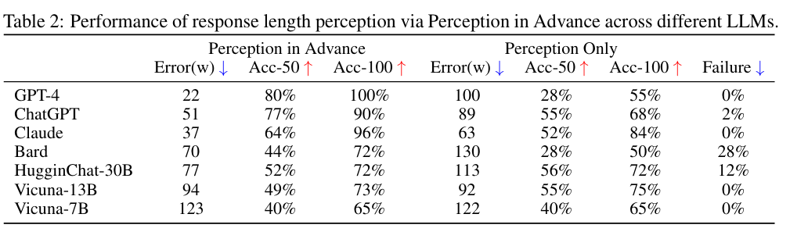
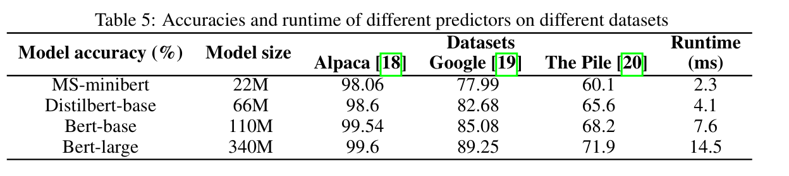
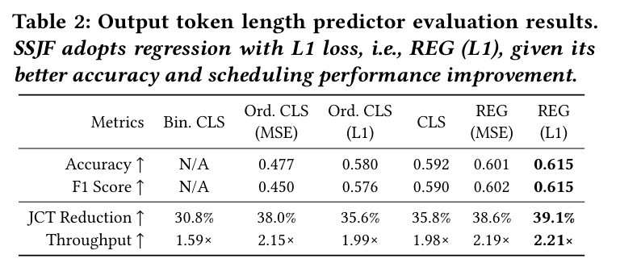
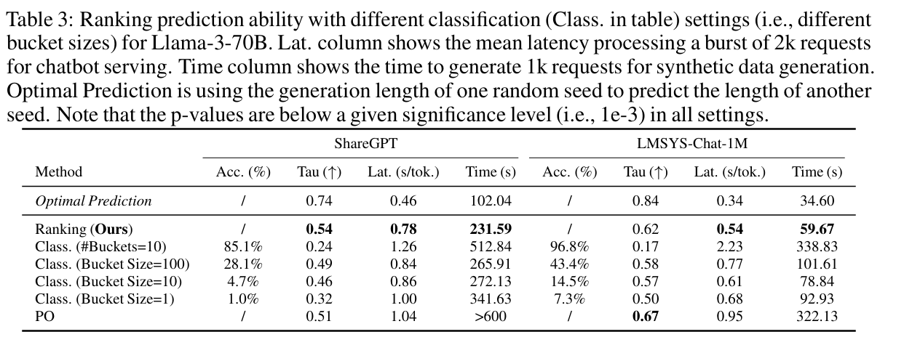
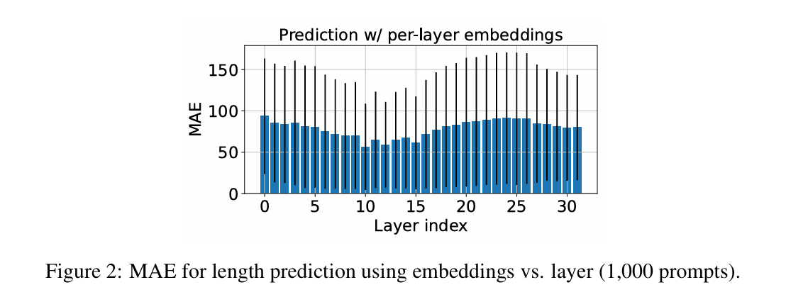
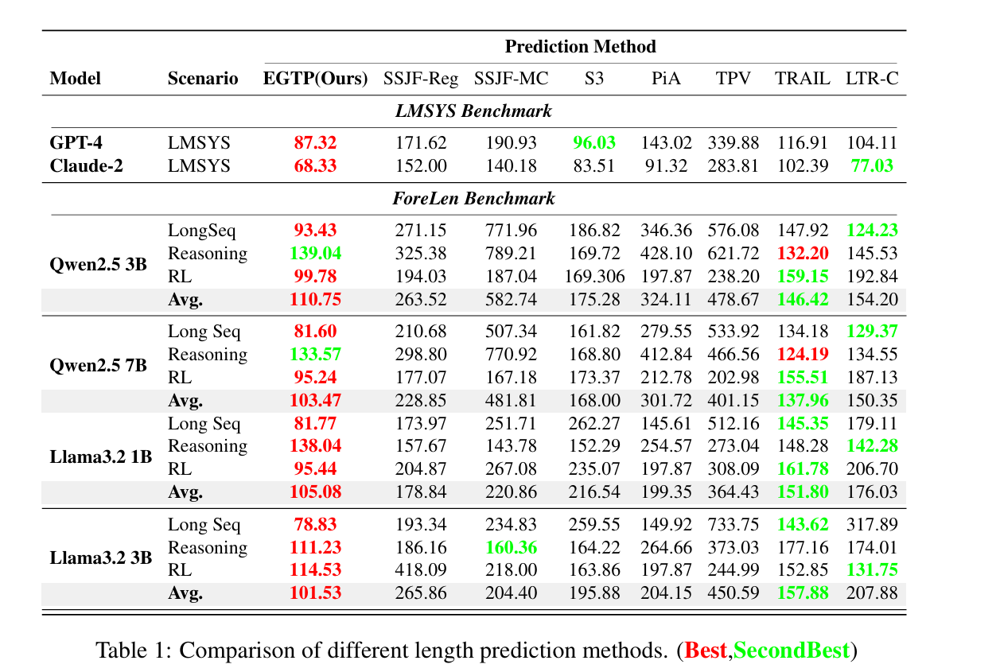

# 前言

大模型推理过程中使用合适的调度的策略能够显著的提升推理的吞吐。但是因为大模型推理的输出长度是不确定的，导致很难进行合理的调度，所以预测QUERY的输出长度就是一项非常重要的工作。

# 近期论文

## Response Length Perception and Sequence Scheduling: An LLM-Empowered LLM Inference Pipeline
- https://arxiv.org/pdf/2305.13144
- 论文时间 [2023.05]
- 核心思想是直接用大模型本身来预测长度，其中有2种方法
    - Perception in Advance(PiA): 通过调整prompt，output过程中先输出长度，再输出response； 缺点： 会影响模型本身的输出内容（大模型能够比较正确对应预测长度和输出内容实际长度，小模型误差比较大；因为要输出预测长度，也会影响模型本身的response内容，特别是小模型输出质量堪忧）
    - Perception Only(PO): 分开预测输出和长度预测；但是结果比较差。 所有需要先训练一个专门输出长度的模型
        - LoRA训练
- 关于调度： 通过让预测出来长度比较接近的query一块调度；同时也处理一些误差的情况（比如预测的比较短，实际比较长）。在当前vLLM中，这些已经不再是问题了
- 实验结果

## S3: Increasing GPU Utilization during Generative Inference for Higher Throughput
- https://proceedings.neurips.cc/paper_files/paper/2023/file/3a13be0c5dae69e0f08065f113fb10b8-Paper-Conference.pdf
- 论文时间 [2023.09]
- 核心思想(S3)
    - 预测长度classification (基于Distilbert模型训练 66M）
        - 预测长度分桶
    - 结合预测长度组Batch调度（已经无用）
- 实验结果
    - 耗时： 2.3~14.5ms (A100)

## Efficient Interactive LLM Serving with Proxy Model-based Sequence Length Prediction
- https://arxiv.org/pdf/2404.08509
- 论文时间 [2024.04]
- github仓库地址： https://github.com/James-QiuHaoran/LLM-serving-with-proxy-models
- 核心思想(SSJF)： 
    - 预测长度，使用预训练的BERT+2层全连接层来预测长度
        - 训练分为2步（提升效率）
            - 第一步： BERT和全连接层都训练
            - 第二步： BERT参数不变，只变更全连接参数
        - 如果输入超过BERT长度（512），则拼接回话记录，只使用最近的512个token作为输入来预测长度
        - 使用L1 Loss来进行分类预测（论文中有5个class）精度0.61（相比5个分类随机0.2高）
    - 基于最短QUERY（输入+输出）来调度
- 实验结论
    - 耗时： 7.6ms(max~20ms)

## Efficient LLM Scheduling by Learning to Rank
- https://arxiv.org/pdf/2408.15792
- 论文时间： [2024.08]
- 核心思想(Ranking, LTR)：
    - 模型训练
        - OPT模型的hidden layer后增加一个lienear layer变为一个浮点数score
            - Output长度（按10为步长进行分桶）为label
            - ListMLE(Kendall’s Tau coefficient)计算loss
        - 对70B模型：  OPT-350m
        - 对8B模型：  OPT-125m
    - 调度：
        - 基于排序调度
        - 针对饥饿请求进行自动调高优先级
- 实验结论：

## DON’T STOP ME NOW: EMBEDDING BASED SCHEDULING FOR LLMS
- https://proceedings.iclr.cc/paper_files/paper/2025/file/9eb8b5ccb0de594a16548f7c058fdadf-Paper-Conference.pdf
- 论文时间 [2024.10], ICLR2025
- 核心思想(TRAIL)：
    - 模型训练
        - 所有token的某一层（or每一层）layer hidden作为输入，经过2层MLP层（第一层输出512,第二层分 buckt~10）
        - 每次迭代都可以计算输出长度，但是因为变化大，需要SMOOTH
    - 调度：
        - 使用SPRPT(shortest predicted remaining processing time) 方案
        - 考虑到比较长(input+output)的query的cache重新计算或者offload成本比较高，所以优先preempt短的query
- 其他资料： 
    - https://minlanyu.seas.harvard.edu/talk/iclr25.pdf
- 实验结论：
    - 耗时： 0.03%占比

## PREDICTING LLM OUTPUT LENGTH VIA ENTROPY-GUIDED REPRESENTATIONS
- https://openreview.net/pdf/2659d97faa4e4968177589486f05554c7e0a473d.pdf
- 论文时间: [2025.] 
- 核心思想(EGTP)：
    - 模型训练
        - EGTP(Entropy-Guided Token Pooling): 不直接使用输入token，而是使用输入token经过模型之后的hidden信息
        - 具体什么模型论文没有介绍
    - PLP(Progressive Length Prediction): 因为很多场景是一个query多个output，所以预测长度不是不变的
        - 不仅仅使用input token也是当前output token作为输入
        - 在输出token的过程中同时迭代进行计算

# 其他资料

- liangyuwang/LLM-Length-Estimation
- Overclocking llm reasoning: Monitoring and controlling thinking path lengths in llm
    - https://arxiv.org/pdf/2506.07240
    - 论文时间： [2025.06]
    - github代码： royeisen/reasoning_loading_bar
    - 这篇论文主要是控制和预测<think></think>部分的长度

- Precise Length Control in Large Language Models
  - https://arxiv.org/pdf/2412.11937
  - 论文时间 [2024.07]
  - 这篇论文是用来控制输出长度的，虽然也涉及到预测输出长度，但是目标是完全不一样的。 是期望能够软性的控制输出长度。
